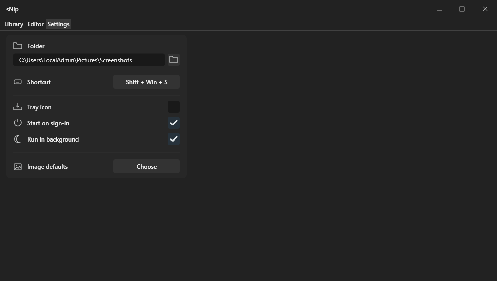

# Install B-UI

Requires Rust on Windows and a local copy of the B-UI library. The library source is not included in this repository.

Add to your project's `Cargo.toml`:

```toml
[dependencies]
b-ui = { path = "C:/path/to/B-UI" }
```

Replace `C:/path/to/B-UI` with your local B-UI folder containing `Cargo.toml`. Then use `use b_ui::*;` in Rust and run `cargo build`.

## Preview

Generated sNip example render:


